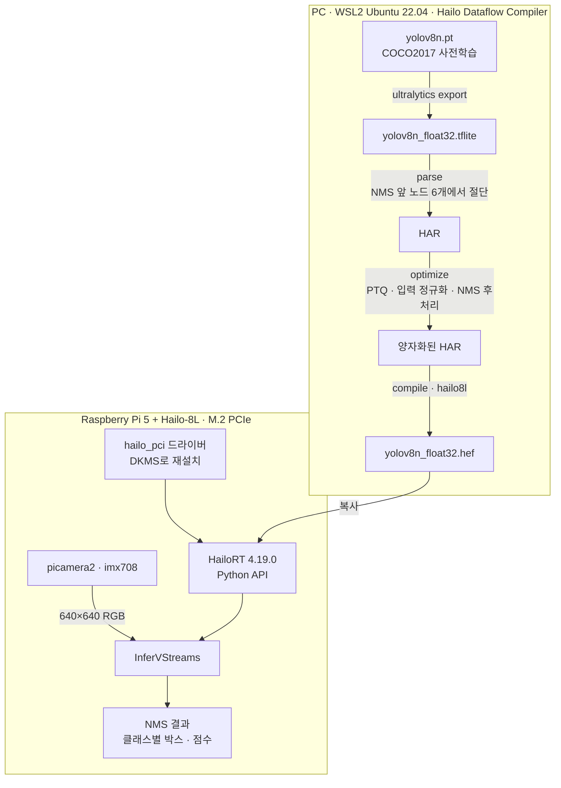
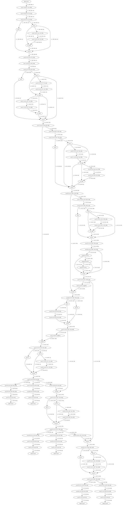

# Hailo-8L NPU on Raspberry Pi 5: YOLOv8n 변환부터 카메라 추론까지

Raspberry Pi 5에 PCIe로 연결한 Hailo-8L NPU에서 YOLOv8n을 돌리기까지의 전 과정을 정리한 레포입니다. PC에서 모델 변환·양자화·컴파일을, Raspberry Pi 5에서 드라이버 설치와 추론을 직접 진행했습니다. 같은 과정을 다른 사람이 따라 할 수 있도록 35장짜리 안내서([docs/Hailo-8L_RPi5_guide.pdf](docs/Hailo-8L_RPi5_guide.pdf))로도 정리했습니다.

> 2024년 하반기, 교내 연구실에서 의뢰받은 소규모 과제를 개인 학습 기록으로 정리한 것입니다.

## 구성

| 구분 | 내용 |
|---|---|
| 보드 | Raspberry Pi 5 (8 GB), Raspberry Pi OS, 커널 6.6.31+rpt-rpi-2712 |
| 가속기 | Hailo-8L, M.2 (PCIe) |
| 카메라 | Raspberry Pi Camera Module (imx708) |
| 개발 PC | WSL2 Ubuntu 22.04, Hailo Dataflow Compiler 3.28 |
| 런타임 | HailoRT 4.19.0, Python 3.11 |
| 모델 | YOLOv8n (ultralytics) |

## 한 일

- YOLOv8n을 TFLite로 내보내고, [Netron](https://netron.app/)으로 그래프를 확인해 NMS 직전의 출력 노드 6개에서 파싱을 끊었습니다. 파싱 결과 그래프는 [docs/yolov8n_parsed.svg](docs/yolov8n_parsed.svg)에 있습니다.

  

  
파싱 결과 그래프 펼치기 (세로로 긴 이미지)

  
  

- COCO2017 train에서 무작위로 1,000장을 뽑아 보정 데이터셋을 만들었습니다. 그 평균과 표준편차로 입력 정규화 레이어를, model script의 `nms_postprocess`로 NMS 후처리를 붙여 정수 양자화(PTQ)한 뒤 Hailo-8L용 HEF로 컴파일했습니다.
- Raspberry Pi 5에서 OS에 미리 들어 있던 드라이버를 제거하고, HailoRT와 같은 버전의 드라이버를 DKMS 패키지로 다시 설치했습니다. 모듈 파라미터를 지정해 적재한 뒤 `lspci`, `lsmod`, `dmesg`로 장치 인식과 펌웨어 로드를 확인했습니다.
- HailoRT Python API로 HEF를 올려 입출력 스트림과 NMS 출력 형식을 확인하고, 카메라 프레임을 연속으로 추론하며 프레임별 지연시간과 FPS를 측정했습니다.

## 막힌 곳과 해결

| 막힌 곳 | 원인 | 해결 |
|---|---|---|
| ultralytics와 Dataflow Compiler를 한 환경에 설치하면 충돌 | 두 패키지가 요구하는 numpy 버전이 다름 | 가상환경을 `ultralytics_env`와 `hailo_env` 두 개로 분리 |
| ONNX로 내보낸 모델의 파싱이 매끄럽지 않음 | ONNX opset 버전 문제 | opset을 바꿔 가며 시도하다가 SavedModel/TFLite 경로로 변경 ([experiments](experiments/README.md)) |
| NMS가 포함된 모델은 파싱 불가 | NMS는 Hailo에서 레이어로 지원하지 않음 | Netron으로 NMS 직전 노드를 찾아 `end_node_names`로 절단하고, 최적화 단계에서 `nms_postprocess`로 다시 붙임 |
| 보정 데이터 전처리 중 예외 | COCO2017에 흑백 이미지가 섞여 있음 | 예외 처리로 해당 이미지를 건너뜀 |
| 입력 정규화를 어디서 할지 | 정규화를 모델에 넣으면 보정 데이터와 추론 입력은 정규화하지 않아야 함 | 정규화 레이어를 모델에 넣고, 보정 데이터와 카메라 프레임은 RGB 그대로 입력 |
| OS 기본 드라이버와 HailoRT 버전 맞추기 | OS에 드라이버가 미리 포함돼 있음 | 기본 모듈을 제거하고 DKMS 패키지로 재설치, 파라미터를 지정해 재적재 ([docs/driver_reinstall.md](docs/driver_reinstall.md)) |
| 가상환경에서 picamera2 import 실패 | picamera2는 시스템 패키지 | `--system-site-packages` 옵션으로 가상환경 생성 |
| 트랜스포머 계열(DETR) 모델로는 진행 불가 | ONNX shape inference 오류 등으로 파싱이 막힘 | 대상 모델을 YOLOv8n으로 변경 ([experiments](experiments/README.md)) |

## 결과

- Hailo-8L용 HEF 컴파일을 마쳤습니다. 입력은 640×640×3이고, HailoRT가 NMS 후처리까지 거친 결과(클래스별 박스 좌표와 점수)를 돌려주는 것을 확인했습니다. 실행 출력은 [notebooks/03_hailort_infer_check.ipynb](notebooks/03_hailort_infer_check.ipynb)에 그대로 남겨 두었습니다.
- 카메라 프레임을 연속으로 추론하면서 프레임별 지연시간과 FPS를 출력하도록 했습니다 ([scripts/04_camera_infer_fps.py](scripts/04_camera_infer_fps.py)).

## 다음 단계

- 검출 박스를 화면에 그리는 시각화
- `InputVStreams`/`OutputVStreams`를 따로 쓰는 비동기 스트리밍 추론
- 양자화 전후 정확도(mAP) 비교

## 실행 순서

| 순서 | 위치 | 파일 |
|---|---|---|
| 1 | PC, `ultralytics_env` | [scripts/01_export_yolov8n.py](scripts/01_export_yolov8n.py) |
| 2 | PC, `hailo_env` | [notebooks/02_dfc_yolov8n_hailo8l.ipynb](notebooks/02_dfc_yolov8n_hailo8l.ipynb) → `hailo_model/yolov8n_float32.hef` |
| 3 | Raspberry Pi 5 | [docs/driver_reinstall.md](docs/driver_reinstall.md) |
| 4 | Raspberry Pi 5, `hailo_env` | [notebooks/03_hailort_infer_check.ipynb](notebooks/03_hailort_infer_check.ipynb) |
| 5 | Raspberry Pi 5, `hailo_env` | [scripts/04_camera_infer_fps.py](scripts/04_camera_infer_fps.py) |

개발 환경 준비(WSL2, 가상환경, COCO2017 내려받기)는 안내서 PDF에 화면과 함께 정리돼 있습니다.

## 이 레포에 넣지 않은 것

- Hailo Dataflow Compiler, HailoRT 설치 파일과 Hailo 문서: [Hailo Developer Zone](https://hailo.ai/developer-zone/) 배포물이라 링크로 대신합니다.
- 컴파일된 모델(HEF, HAR), 변환된 모델(TFLite), COCO2017 데이터

## 참고

- [Parsing YOLO models with the Hailo Dataflow Compiler tool (Hailo Community)](https://community.hailo.ai/t/parsing-yolo-models-withthe-hailo-dataflow-compiler-tool/2384)
- [Hailo Model Zoo: postprocess config](https://github.com/hailo-ai/hailo_model_zoo/tree/master/hailo_model_zoo/cfg/postprocess_config)
- [Ultralytics](https://github.com/ultralytics/ultralytics)
- [Netron](https://netron.app/)
