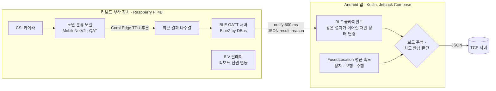
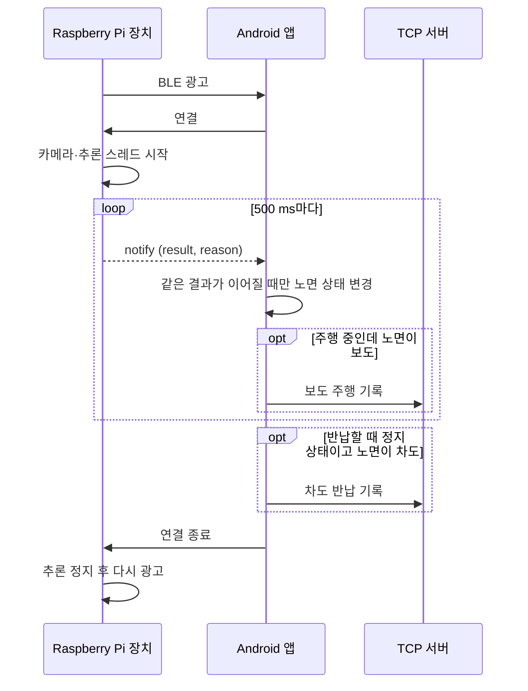

# 공유 킥보드 보도 주행 판별 장치 (2024 졸업작품)

킥보드에 붙이는 장치가 전방 노면이 보도인지 차도인지 판별하고, 그 결과를 BLE로 사용자의 안드로이드 앱에 보냅니다. 앱은 스마트폰 위치 정보로 정지·보행·주행 상태를 판단해, 보도 주행이나 차도 반납이 일어나면 서버에 기록합니다.

- 2024년 1학기, 4인 팀 졸업작품, 팀장
- 라즈베리파이 장치 코드, 노면 분류 모델, 안드로이드 앱을 직접 작성
- 개발비 50만 원 안에서 동작하는 시연품을 완성해 졸업작품전에 전시

## 구성

### 통신 흐름

| 구분 | 내용 |
|---|---|
| 장치 | Raspberry Pi 4B, Raspberry Pi 카메라(CSI), Coral USB Accelerator, 5 V 릴레이, 3.3 V-5 V 레벨 컨버터 |
| 장치 소프트웨어 | Python, tflite_runtime + libedgetpu, picamera2, BlueZ D-Bus (dbus-python, GLib) |
| 모델 | TensorFlow/Keras, MobileNetV2, 양자화 인식 학습(tfmot), Edge TPU 컴파일 |
| 앱 | Kotlin, Jetpack Compose, ViewModel + StateFlow, 코루틴, Android BLE API, FusedLocationProvider |

## 폴더

| 폴더 | 내용 |
|---|---|
| [device/](device/README.md) | 라즈베리파이 장치 코드: 카메라 추론, BLE GATT 서버 |
| [app/](app/README.md) | 안드로이드 앱 소스. MVVM 구조도, 화면 전환, 클래스 다이어그램, MVVM 자체 점검 |
| [model/](model/README.md) | 노면 분류 모델 학습과 양자화 (정리 중) |

## 막힌 곳과 해결

| 막힌 곳 | 해결 |
|---|---|
| GPS 오차 때문에 위치만으로는 보도와 차도를 구분할 수 없음 | 킥보드 전방 카메라 영상으로 노면을 분류 |
| 처음 설계(이미지 분할 + 단안 깊이 추정 + 자이로)가 저전력 장치와 일정 안에 들어가지 않음 | 노면 3분류(자전거도로·차도·보도) 모델로 줄이고, 이동 상태는 스마트폰 위치 정보로 판단하도록 범위를 조정 |
| 주행 중 진동으로 영상이 흔들림 | 학습 데이터에 MotionBlur 등 증강을 적용 |
| 학습 후 정수 양자화를 하면 정확도가 크게 떨어짐 | 양자화 인식 학습(QAT)으로 전환 |
| 양자화 인식 학습 도구가 Hardswish와 어텐션 구조를 지원하지 않음 | MobileNetV3, MobileViT 대신 MobileNetV2를 최종 모델로 선택 |
| Coral 공식 런타임이 최신 Raspberry Pi OS의 파이썬에서 비정상 종료 | 지원되는 구버전 파이썬을 소스로 빌드해 보다가, 커뮤니티가 유지하는 런타임 빌드로 교체 |
| 런타임 교체 뒤 가속기 장치 로드 실패 | udev 규칙을 직접 설정 |
| BlueZ D-Bus API가 낯섦 | BlueZ 문서와 Bluetooth SIG 학습 자료로 구조를 익히고, Advertisement·Application·Service·Characteristic을 클래스로 감쌈 |
| 프레임마다 추론 결과가 흔들림 | 장치에서 최근 결과를 다수결로 묶고, 앱에서는 연속으로 같은 결과일 때만 상태를 바꿈 |
| 연결이 끊겼다 다시 붙으면 추론이 다시 시작되지 않음 | 파이썬 스레드는 한 번만 시작할 수 있어, 연결될 때마다 추론 스레드를 새로 만들도록 수정 |

## 이 레포에 넣지 않은 것

- 학습 데이터: 공개 데이터셋(AI Hub 인도 보행 영상)을 가공해 썼고, 재배포가 허용되지 않아 넣지 않았습니다.

## 다음 단계

- BLE 서비스 UUID를 자체 128비트 UUID로 교체 (지금은 학습 자료 예제의 UUID를 그대로 사용)
- 모델 학습 코드 정리 후 `model/`에 추가
