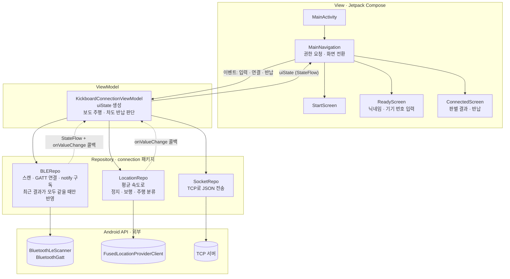
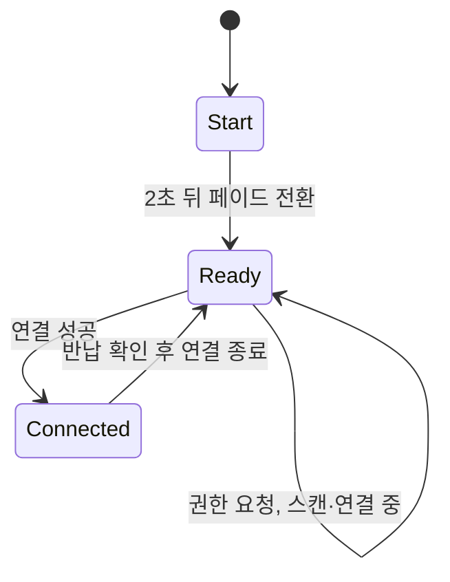
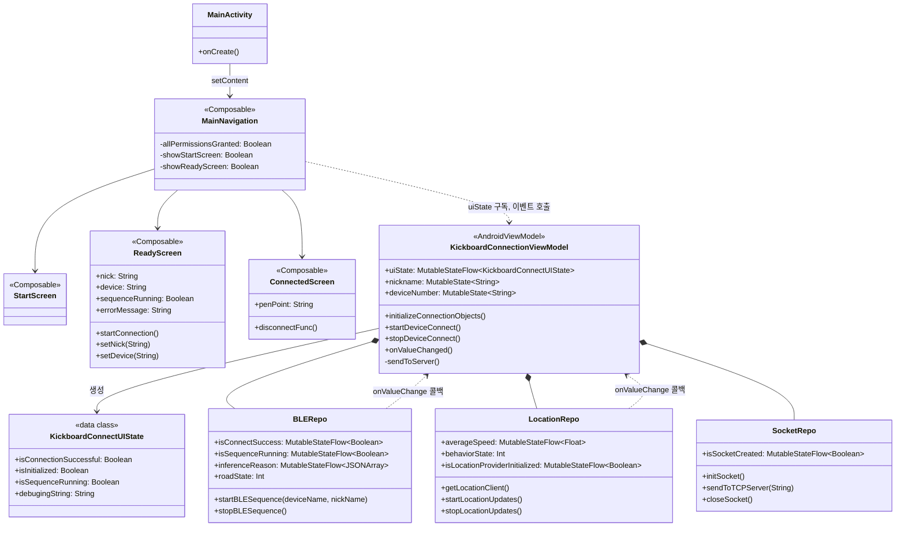

# app: 안드로이드 앱

장치와 BLE로 연결해 노면 판별 결과를 받고, 위치 정보로 이동 상태를 판단해 서버에 기록하는 앱입니다.
Jetpack Compose 화면, ViewModel, 세 개의 Repository(BLE, 위치, TCP 소켓)로 나눈 MVVM 구조입니다.

## 구조

화면은 ViewModel의 `uiState`만 구독하고, 사용자 입력은 이벤트(함수 호출)로 ViewModel에 올려 보냅니다.
ViewModel은 세 Repository를 묶어 화면 상태를 만들고, 보도 주행과 차도 반납을 판단해 서버로 보냅니다.

### 화면 전환

### 클래스 다이어그램

## 파일

| 파일 | 역할 |
|---|---|
| `navigation/MainNavigation.kt` | 권한 요청, 화면 전환 (시작 → 연결 준비 → 연결됨) |
| `viewmodel/KickboardConnectionViewModel.kt` | BLE, 위치, 소켓 세 Repository의 상태를 StateFlow로 모아 화면에 전달. 보도 주행·차도 반납 시 서버 전송 |
| `connection/BLERepo.kt` | 기기 이름으로 스캔 → GATT 연결 → notify 구독. 최근 결과(최대 4개)가 모두 같을 때만 노면 상태를 바꿈 |
| `connection/LocationRepo.kt` | 최근 속도 평균으로 정지(0.91 m/s 미만) / 보행(1.6 m/s 미만) / 주행 판단 |
| `connection/SocketRepo.kt` | TCP 소켓으로 JSON 전송 (입출력 전용 디스패처에서 실행) |
| `screens/` | Jetpack Compose 화면 |

## MVVM 적용 수준 (자체 점검)

| 원칙 | 적용 | 근거 |
|---|---|---|
| View는 Repository를 모르고 ViewModel만 사용 | 지킴 | `screens/`와 `MainNavigation`은 ViewModel의 `uiState`와 함수만 씀 |
| 화면 상태를 하나의 UI 상태로 노출 | 지킴 | `KickboardConnectUIState`를 StateFlow로 노출, `collectAsStateWithLifecycle`로 구독 |
| 화면은 상태를 받고 이벤트를 올려 보냄 | 대부분 지킴 | `ReadyScreen`, `ConnectedScreen`은 값과 람다만 받음. 다만 입력값(`nickname`, `deviceNumber`)은 `uiState` 밖의 Compose State로 따로 둠 |
| 상태는 소유자만 변경 | 부분 | `uiState`와 Repository의 상태가 `MutableStateFlow` 그대로 공개돼 밖에서도 값을 바꿀 수 있음 |
| 데이터는 Repository → ViewModel로 Flow를 따라 흐름 | 부분 | 연결 상태는 StateFlow로 받지만, 노면·이동 상태 변화는 Repository가 ViewModel 함수(`onValueChange`)를 직접 부르는 콜백 구조 |
| 데이터 계층은 UI 라이브러리와 무관 | 부분 | `BLERepo`가 Compose의 `mutableStateOf`를 씀 |
| 비즈니스 규칙의 위치 | 부분 | 노면 필터와 이동 상태 임계값이 Repository에 있고, 연결 전 초기화 판단이 View(`MainNavigation`)에 있음 |
| 의존성 주입과 테스트 가능성 | 안 지킴 | ViewModel이 Repository를 직접 생성. 인터페이스와 주입 없음 |
| 오류 상태 전달 | 안 지킴 | `ReadyScreen`에 `errorMessage` 자리는 있지만 ViewModel이 오류 상태를 내보내지 않음. 스캔 실패 시 예외를 던짐 |

View–ViewModel–Repository로 나눈 뼈대와 단일 UI 상태는 MVVM을 따랐습니다. 다만 Repository에서 ViewModel로 가는 방향이 Flow가 아니라 콜백이라, 데이터 흐름은 절반만 MVVM입니다.

## 다음에 고칠 것

- Repository는 읽기 전용 `StateFlow`(`asStateFlow()`)만 내보내고, ViewModel이 `combine(roadState, behaviorState)`로 판단하도록 바꿔 콜백을 없앰
- 노면 필터와 이동 상태 분류를 순수 함수로 분리해 단위 시험 추가
- Repository 인터페이스와 생성자 주입(Hilt 또는 `ViewModelProvider.Factory`) 도입
- 오류를 `uiState`로 전달하고, 연결 버튼 처리(초기화 → 연결)를 ViewModel 함수 하나로 모음
- `SocketRepo`의 코루틴을 수명이 관리되는 scope에서 실행

## 빌드 전에

- 소스만 정리한 폴더라 Gradle 래퍼와 루트 빌드 파일은 들어 있지 않습니다. Android Studio에서 새 Compose 프로젝트를 만든 뒤 `app/src`를 옮겨 넣는 방식으로 빌드합니다.
- 글꼴(`res/font/`)과 배경·로고 이미지(`res/drawable/background*.png`, `logo*.png`)는 라이선스를 확인하지 못해 뺐습니다. 같은 이름의 리소스를 넣어야 빌드됩니다.
- `SocketRepo.kt`의 서버 주소는 시연 때 쓴 TCP 터널 주소를 지우고 예시 값으로 바꿨습니다.
