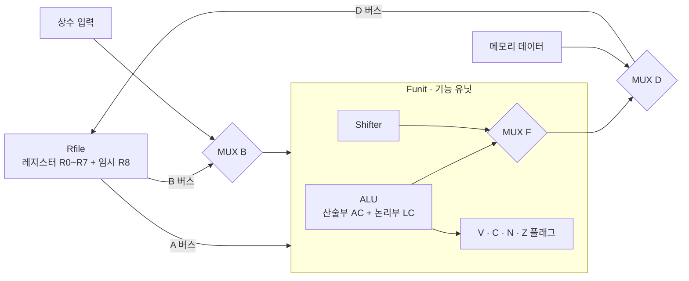
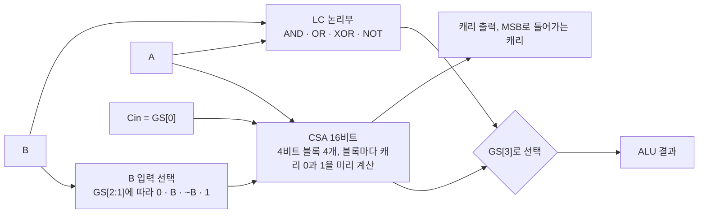
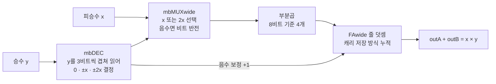

# 16비트 CPU 데이터패스: Verilog ALU · 가산기 · Booth 곱셈기 (2019 디지털시스템설계)

2019년 2학기 디지털시스템설계 과목에서 팀으로 만든 마이크로프로그램 제어 CPU 가운데, 제가 작성한 **데이터패스 모듈만** 정리했습니다.
- **11월 데이터패스:** 산술·논리 연산부(ALU), carry-select 가산기, 시프터, 레지스터 파일, 상태 플래그. 이 ALU는 수정 없이 팀의 최종 CPU에 들어가 DE2-115 FPGA 보드에서 동작했습니다.
- **12월 곱셈기:** 폭을 파라미터로 바꿀 수 있는 radix-4 Booth 곱셈기. 최종 CPU의 산술부에 곱셈 연산으로 연결했습니다.

2026년에 자가 검증 테스트벤치를 새로 붙여 다시 검증했습니다. ALU 16개 연산과 Booth 곱셈기(8비트 전수 65,536가지)는 모두 통과했고, 시프터에서는 당시 놓친 비트 범위 버그를 찾았습니다.

> 제어부(마이크로프로그램 제어 메모리, 제어 주소 레지스터), 메모리, 보드 연결은 팀 작업이라 이 폴더에 넣지 않았습니다.

## 구성



### ALU 내부



| 파일 | 내용 |
|---|---|
| [`src/HA1.v`](src/HA1.v) | 반가산기. 가산기에서 전파(P)·생성(G) 신호를 만드는 데 사용 |
| [`src/CLA.v`](src/CLA.v) | 4비트 가산기 블록 (P·G 기반) |
| [`src/CSA.v`](src/CSA.v) | carry-select 가산기. 4비트 블록마다 캐리 0과 1의 결과를 동시에 계산해 두고, 앞 블록의 캐리로 하나를 고름 |
| [`src/AC.v`](src/AC.v) | 산술부. B 입력을 0, B, ~B, 1로 바꿔 CSA에 넣어 덧셈·뺄셈·증감을 한 회로로 처리 |
| [`src/LC.v`](src/LC.v) | 논리부. AND, OR, XOR, NOT |
| [`src/ALU.v`](src/ALU.v) | 산술부와 논리부를 GS[3]로 선택 |
| [`src/Shifter.v`](src/Shifter.v) | 시프터 (통과, 오른쪽, 왼쪽) |
| [`src/Funit.v`](src/Funit.v) | 기능 유닛. ALU와 시프터를 FS[4]로 선택하고 V·C·N·Z 플래그 생성 |
| [`src/Rfile.v`](src/Rfile.v) | 레지스터 파일. 쓰기 1포트, 읽기 2포트 |
| [`src/cpu_dp.v`](src/cpu_dp.v) | 위 모듈과 버스 MUX를 묶은 데이터패스 |

### ALU 연산표 (GS)

| GS | 연산 | GS | 연산 |
|---|---|---|---|
| 0000 | A | 0110 | A − 1 |
| 0001 | A + 1 | 0111 | A |
| 0010 | A + B | 100x | A AND B |
| 0011 | A + B + 1 | 101x | A OR B |
| 0100 | A + ~B | 110x | A XOR B |
| 0101 | A − B | 111x | NOT A |

플래그는 V(오버플로: MSB로 들어가는 캐리와 나가는 캐리의 XOR), C(캐리), N(최상위 비트), Z(결과가 0)입니다.

## 검증 (2026)

[`tb/tb_datapath.v`](tb/tb_datapath.v)는 각 연산의 결과를 Verilog 기준 모델과 비교하는 자가 검증 테스트벤치입니다. 무작위 값과 경계값(0xFFFF + 1, 0x7FFF + 1 등)을 함께 넣었습니다. 실행 결과 원문은 [`sim/modelsim_result.txt`](sim/modelsim_result.txt)에 있습니다.

| 대상 | 검사 | 결과 |
|---|---|---|
| ALU | 16개 연산 × 무작위 2,000개 (결과와 캐리) | **32,000 / 32,000 통과** |
| Funit 플래그 | A + B, A − B에서 V·C·N·Z 4,000건 | **4,000 / 4,000 통과** |
| Shifter 통과 (HS=00) | 500건 | 500 / 500 통과 |
| Shifter 오른쪽 (HS=01) | 500건 | **0 / 500** (아래 버그) |
| Shifter 왼쪽 (HS=10) | 500건 | **241 / 500** (아래 버그) |

```text
ModelSim ALTERA Starter Edition 10.5b
vlib work
vlog src/HA1.v src/CLA.v src/CSA.v src/AC.v src/LC.v src/ALU.v src/Shifter.v src/Funit.v src/Rfile.v src/cpu_dp.v tb/tb_datapath.v
vsim -c tb_datapath -do "run -all; quit -f"
```

## 재검토에서 찾은 문제 (2019년 코드 그대로 둠)

| 위치 | 문제 | 고치는 방법 |
|---|---|---|
| `Shifter.v` 오른쪽 시프트 | `{IR, busB[BW-1]}`이 2비트만 만들어, 결과가 0x0001 같은 값이 됨 | `{IR, busB[BW-1:1]}` |
| `Shifter.v` 왼쪽 시프트 | `{busB[BW-3:0], IL}`이 15비트라 최상위 비트 하나가 사라짐. 그래서 절반 정도만 맞음 | `{busB[BW-2:0], IL}` |
| `cpu_dp.v` | `MM`이 선언만 되고 구동되지 않아 `Aout`이 정해지지 않음. 3비트 주소를 4비트 포트에 연결해 임시 레지스터 R8에 접근할 수 없음 | 제어 워드에 MM 비트를 추가하고 주소 폭을 맞춤 |
| `CLA.v` | 이름은 carry lookahead지만 캐리를 앞 비트에서 차례로 넘기는 식이라 실제로는 리플 구조 | 각 캐리를 P·G의 곱의 합으로 펼친 lookahead 식으로 변경 |

이 문제들은 당시 팀 통합 과정에서 최종 CPU 쪽 코드에서는 고쳐졌습니다. 이 폴더에는 제가 작성한 2019년 원본을 그대로 두고, 재검토 결과만 기록했습니다.

## Radix-4 Booth 곱셈기 (2019년 12월)

곱셈을 덧셈 반복 대신 한 번에 하기 위해 만든 부호 있는 곱셈기입니다. 승수를 2비트씩 묶어(radix-4) 부분곱 개수를 절반으로 줄이고, 부분곱은 캐리를 바로 전파하지 않는 캐리 저장(carry-save) 방식으로 더해 결과를 두 벡터(outA, outB)로 냅니다. 두 벡터를 마지막에 한 번 더하면 곱이 됩니다.



| 파일 | 내용 |
|---|---|
| [`src/booth/partMBM.v`](src/booth/partMBM.v) | 최상위. 부분곱 생성과 캐리 저장 덧셈을 `generate`로 폭(BW)에 맞춰 펼침 |
| [`src/booth/mbDEC.v`](src/booth/mbDEC.v) | Booth 부호화. 승수 3비트로 ×1, ×2, 부호를 결정 |
| [`src/booth/mbMUX.v`](src/booth/mbMUX.v), [`mbMUXwide.v`](src/booth/mbMUXwide.v) | 비트마다 x와 2x 중 하나를 고르고, 음수면 XOR로 반전 |
| [`src/booth/FAwide.v`](src/booth/FAwide.v), [`FA1.v`](src/booth/FA1.v) | 전가산기를 나란히 놓은 캐리 저장 덧셈 줄 |

팀 최종 CPU에서는 산술부의 연산 코드 중 원래 A를 그대로 내보내던 GS=0111(A − 1 + 1) 자리를 곱셈으로 바꿔, 두 벡터를 32비트 가산기로 더한 하위 16비트를 결과로 썼습니다.

### 검증 (2026)

[`tb/tb_booth.v`](tb/tb_booth.v), 결과 원문은 [`sim/booth_result.txt`](sim/booth_result.txt)에 있습니다.

| 대상 | 검사 | 결과 |
|---|---|---|
| 8비트 곱셈기 | 부호 있는 모든 조합 256 × 256 | **65,536 / 65,536 통과** |
| 16비트 곱셈기 | 무작위 20,000건 + 경계값(−32768 × −32768, 32767 × 32767 등) | **20,000 / 20,000 통과** |
| 팀 최종 산술부에 연결한 곱셈 연산 | 무작위 20,000건, 하위 16비트 비교 (팀 코드라 이 폴더에는 없음) | 20,000 / 20,000 통과 |

### 재검토에서 찾은 점

| 위치 | 내용 |
|---|---|
| `partMBM.v`, `mbMUXwide.v`, `FAwide.v` | 하위 모듈을 인스턴스 이름 없이 불러, Quartus에서는 컴파일되지만 표준 Verilog 시뮬레이터(ModelSim)는 거부합니다. 검증은 `FA1 u_fa (...)`처럼 이름만 붙인 사본으로 했습니다 |
| `partMBM.v` 첫 덧셈 줄의 `(BW+1)*{1'b0}` | 의도는 0을 BW+1비트로 복제하는 `{(BW+1){1'b0}}`이지만, 곱셈식이라 32비트 0이 되어 폭 경고가 납니다. 값은 0이라 결과에는 영향이 없습니다 |

## 이 폴더에 넣지 않은 것

- 팀이 함께 만든 제어부, 메모리, 보드 연결 코드와 Quartus 프로젝트 파일
- 과목 강의 자료

## AI 활용

Verilog 모듈은 2019년에 직접 작성했고, 2026년 재검토 때 테스트벤치(`tb/`)와 문서 작성에 Claude Code를 활용했습니다.
